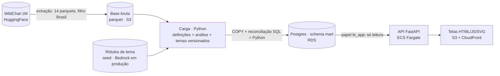

# Retenção de um assistente de IA: achados e decisões

**Pergunta do cliente:** o que faz uma pessoa que experimentou o assistente voltar a usá-lo em até 7 dias? Quais fatores têm o maior efeito, quanto pesa cada um e quanto disso é causa e não seleção?
**Base:** WildChat-1M, conversas com `country = 'Brazil'`: 11.621 conversas, 2.266 pessoas novas elegíveis (abr/2023–abr/2024).
**Detalhe de cada etapa:** [`docs/analise/`](analise/) (qualidade, definições, variáveis, EDA, temas, análise) · decisões: [`docs/bdr/`](bdr/), [`docs/adr/`](adr/) · incidente: [`docs/incidente-4.2.md`](incidente-4.2.md).

## 1. A resposta

**18,4% voltam** em outro dia, entre o 1º e o 7º dia depois do primeiro uso (IC 95%: 16,8–20,0).

| # | Achado (efeito ajustado, IC 95%) | Decisão que sustenta |
|---|---|---|
| 1 | **1 em cada 5 pessoas chega só testando (14,6%) ou pedindo imagem, vídeo ou áudio (4,4%)** e volta ~6%, contra ~21% de quem chega com um pedido real: **−15,6 pp [−19,6; −11,6]** e **−14,7 pp [−18,7; −10,7]**. | Redesenhar a 1ª resposta para quem só testa (usos concretos com exemplos) e responder pedido de mídia com uma alternativa útil em vez de recusar. Validar com A/B. Fechar metade da distância = **+1,4 pp** no retorno total. |
| 2 | **O modelo não muda o retorno.** GPT-4: −1,1 pp [−5,8; +3,6] ajustado; +2,9 pp [−1,7; +7,3] por IPW; +1,7 pp quando a pessoa escolhia e +1,3 pp quando era o padrão, ambos cruzando o zero. | Não usar modelo mais caro como alavanca de retenção; investir na 1ª experiência. |
| 3 | **No celular, o retorno é 7,9 pp menor** [−11,3; −4,4], com o mesmo tema, idioma, horário e época. | Auditar a experiência mobile e testar uma versão otimizada em A/B; acompanhar celular como segmento de risco. |

**Causa ou seleção.** A época (o GPT-4 vai de 0% a 94% das conversas ao longo do ano), a intenção ao chegar e o perfil foram controlados; o engajamento do 1º dia ficou fora, como mediador. No GPT-4, a igualdade entre "escolhido" e "padrão" indica que não há seleção relevante. **O que não está provado:** que mudar a 1ª experiência fará as pessoas voltarem; sem experimento, sobra confusão não observada (motivação, necessidade). Por isso cada decisão vem com um A/B.

**A semana de 20/11/2023** caiu 10,4 pp contra as 4 anteriores. A decomposição mostra que mudou **a taxa dentro de cada perfil** (−10,0 pp), não o perfil de quem chegou (−0,4 pp). Mas com ~50 pessoas por semana o teste entre as 37 semanas não distingue a variação do acaso (p = 0,21). O dashboard mostra a incerteza de cada semana em vez de alarmar com uma semana isolada.

Os efeitos de todos os fatores, a qualidade da resposta e o que os dados permitem ou não medir estão em [`analise/06-analise.md`](analise/06-analise.md).

## 2. Premissas (assumidas sem resposta do cliente) e o que muda se estiverem erradas

| Premissa | Escolha | Se estiver errada |
|---|---|---|
| Quem é o usuário | `hashed_ip` (não há login) | IP + navegador: 20,2%; IPs unidos pela conversa: 18,1% |
| O que é "voltar" | usar em **outro dia local**, D+1 a D+7 (o PDF fala em "em que fuso horário conta um dia") | nova sessão no mesmo dia já contando: **28,1%**, a premissa que mais pesa |
| O que conta como uso | cada resposta do assistente (só o assistente tem horário) | só conversa nova: 17,1% |
| Fuso | São Paulo para todo o Brasil | UTC: 19,6%. O Brasil tem 4 fusos: no Amazonas e no Acre, o dia vira 1 ou 2 horas mais tarde que em São Paulo |
| Período | base inteira, sem os primeiros 14 dias (falso "novo") e sem os últimos 8 (janela incompleta) | sem cortes: até 18,7% |
| Base | pública, sem as conversas tóxicas | o retorno medido é um **limite inferior** |
| Sessão | só como sensibilidade: pausa de 15, 30 ou 60 min | 33,4%, 28,1% ou 24,6% se nova sessão contasse como volta |
| Janela | 7 dias, como na pergunta | 15,8% com 3 dias; 19,8% com 14 |
| Tema | da conversa inteira da 1ª conversa, entre 11 temas fixos | depende do classificador: estável (κ = 0,95) e confirmado em 5 de 5 hipóteses |
| Engajamento do 1º dia | fora do modelo, como consequência (mediador) | controlá-lo apagaria o efeito de uma boa 1ª experiência |
| Amostra mínima | 30 pessoas para mostrar um número; 99% de confiança nas frases | abaixo disso, o número oscila demais por acaso |
| País | `country` inferido do IP | conversas por VPN entram ou saem do Brasil; não há dado para medir |

Opções consideradas em cada uma: [`bdr/BDR-001`](bdr/BDR-001-definicoes-de-uso-e-retorno.md).

## 3. O dashboard

Sobe com `docker compose up --build` e abre em `http://localhost:8000`. É um **self-host BI**: quem é de negócio explora sozinho, sem notebook, e confere cada número. Duas telas ([BDR-003](bdr/BDR-003-o-que-o-dashboard-mostra.md)):

| Tela | Pergunta | Gráficos e por quê |
|---|---|---|
| **A resposta** (abre primeiro; fixa, base inteira) | O que faz voltar, quanto pesa cada fator e quanto disso vinha do perfil de quem chega? | Tudo em **"de cada 100 pessoas"**. No topo, o número principal com a margem de erro; **"o que mais pesa"**: ponto e linha por fator (o efeito e a margem de erro, ordenados pelo tamanho; a linha que cruza o zero mostra na hora o que não faz diferença); **"quanto vinha do perfil"**: dois pontos por fator, a diferença comparando todo mundo e a que sobra comparando pessoas parecidas (a distância entre eles é a seleção). Depois, os 3 achados em **barras com margem de erro** e "o que fazer"; GPT-4 por três formas de medir; a semana de 20/11 em barras e na tabela perfil × retorno; **retorno semana a semana** com a faixa do acaso (separa variação real de sorte); mediadores, insatisfação, sensibilidade às regras e como os temas foram classificados. Termos técnicos (IC, regressão, IPW, pseudo-R²) só no detalhe técnico |
| **Explorar** (com filtros: período do 1º uso, idioma, dispositivo, tema da 1ª conversa, modelo) | Neste recorte, quantos voltam, como isso evoluiu e quem volta mais? | Números principais; **linha** do retorno mês a mês com a margem de erro sombreada (tendência); **colunas** de pessoas novas por mês (volume); **barras horizontais** por idioma, dispositivo, modelo e tema (comparar grupos); barras lado a lado "% das pessoas × % das conversas" por tema (peso de quem usa muito). Frases por regra que mudam com o filtro. No topo, uma faixa-resumo da resposta, que não muda com os filtros |

**Linguagem.** "De cada 100 pessoas", "margem de erro", "mesmo considerando idioma, aparelho, horário, tema e época", "pode ser acaso", "não faz diferença comprovada". Cada gráfico tem "Como calculamos?" com uma explicação simples e o detalhe técnico recolhível, mais a consulta SQL.

**Frases automáticas (Explorar).** São regras fixas, sem LLM (`app/insights.py`, testadas):
- com menos de 30 pessoas, não concluem nada;
- uma diferença só é "confirmada" se passar no teste de duas proporções com 99% de confiança (mais exigente, porque quem explora faz muitas comparações);
- caso contrário, a frase diz "pode ser acaso".

**Indicadores.** Definição, fórmula, denominador, período e a **consulta SQL de cada um** estão em [`indicadores.md`](indicadores.md).

| Indicador | Fórmula | Denominador | Período |
|---|---|---|---|
| Retorno em 7 dias | pessoas com uso em D+1..D+7 ÷ pessoas novas | pessoas novas elegíveis | 1º uso entre 22/04/2023 e 21/04/2024, ou o período do filtro |
| Retorno por mês, semana ou grupo | o mesmo, por mês, semana ou grupo do 1º uso | pessoas novas do mês, semana ou grupo | mês, semana ou grupo |
| Efeito de um fator | efeito marginal médio da regressão logística (pontos percentuais) | as 2.266 pessoas | base inteira |

**Amostra pequena:** com menos de 30 pessoas, a API não devolve nenhum número do grupo, nem a contagem. A tela mostra "menos de 30" e "amplie o recorte" no recorte, deixa o mês sem ponto e escreve "poucas pessoas" no lugar da barra.

**Indicadores que só fizeram sentido depois de olhar os dados**, já no dashboard:
- retorno por tema da 1ª conversa;
- a fatia de quem chega "só testando" ou "pedindo imagem";
- retorno por dispositivo;
- "% das pessoas × % das conversas";
- a sensibilidade à forma de medir.

Proposto para a próxima versão: o acompanhamento em janela móvel de 4 semanas.

**O que o dashboard mostra e o que nunca mostra.** Mostra só agregados e efeitos. **Nunca** mostra texto de conversa, IP, user-agent, estado ou número de grupo com menos de 30 pessoas. A API devolve esses números vazios, e um teste garante isso. A base analítica nem chega a guardar texto, IP ou user-agent: o usuário vira `sha256(sal + hashed_ip)`.

## 4. Arquitetura

| Componente local | Na AWS | Por quê |
|---|---|---|
| Volume `bruto` (parquet) | S3 | base bruta barata e versionável |
| Serviço `etl` | ECS Fargate agendado por EventBridge | roda o mesmo container, sem servidor ligado |
| Postgres | RDS PostgreSQL (backup automático) | volume pequeno; SQL legível por qualquer pessoa da equipe de dados |
| Serviço `app` | ECS Fargate atrás de ALB; página em S3 + CloudFront | API fina e página estática |
| Classificação de tema | Amazon Bedrock (`LLM_PRIMARY_PROVIDER=bedrock_converse`) | o LLM fica na AWS; troca só de configuração |
| Senhas, sal do pseudônimo | Secrets Manager | nada de segredo no código |
| Logs e métricas | CloudWatch | um lugar para a carga e a API |
| Login (fora do escopo local) | Cognito no ALB | o cliente vê só o próprio dashboard |

**Modelo da base analítica** (schema `mart`, [`etl/sql/`](../etl/sql/)):

| Objeto | Grão | Chave | Quem escreve → quem lê |
|---|---|---|---|
| `conversas` | uma conversa (sem texto, IP ou user-agent) | `conv_id` | carga → app |
| `eventos` | uma resposta do assistente (horário de uso) | `usuario_id`, `ts` | carga → views |
| `perfil_usuario` | uma pessoa: idioma, dispositivo, tema e modelo da 1ª conversa | `usuario_id` | carga → app |
| `vw_usuarios` / `mv_usuarios` | uma pessoa elegível: 1º dia, semana, voltou | `usuario_id` | SQL (definição do BDR-001) |
| `vw_explorar` | `mv_usuarios` + `perfil_usuario` | `usuario_id` | app (tela Explorar) |
| `mv_coortes_semanais`, `vw_retorno_geral` | semana / total, com IC de Wilson | `semana` | app |
| `efeitos`, `gpt4_selecao`, `semana_decomposicao`, `sensibilidade`, `testes`, `uso_por_categoria` | resultados da análise estatística | — | carga → app (Análise completa) |
| `cargas`, `migracoes` | uma execução / uma migração | `id` / `nome` | carga → app (procedência) |

**Endpoints**

| Endpoint | Entrada | Saída |
|---|---|---|
| `GET /api/explorar` | `inicio`, `fim` (AAAA-MM-DD) e `idioma`, `dispositivo`, `tema`, `modelo` (opcionais; valor fora da lista → 400) | recorte e base com margem de erro, série mensal, retorno por grupo nas 4 dimensões, chegada por tema, frases, opções dos filtros, procedência, SQL |
| `GET /api/analise` | — | retorno geral e por semana, efeitos bruto e ajustado com IC, GPT-4 por três métodos, decomposição da semana, sensibilidade, testes, procedência, SQL |
| `GET /healthz` | — | `{"status": "ok"}` |

Documentação interativa em `/api/docs`.

**Outros países.**
- **Interface:** a tela usa `Intl` e textos centralizados; basta um dicionário por idioma.
- **Fuso:** é o ponto crítico, porque o retorno é por dia local. O fuso deixa de ser constante e vira coluna `fuso` por país (ou por estado, para países com vários), usada em `vw_usuarios` no lugar de `'America/Sao_Paulo'`.
- **Comparação:** `pais` entra como dimensão em todas as tabelas do `mart` e nas rotas (`?pais=`). O modelo de efeitos roda por país, e os países são comparados pelos efeitos com IC, não por taxas brutas, porque o perfil de chegada muda entre eles.
- **Temas:** precisam de revalidação por idioma.

**Desempenho.**
- **Pré-calculado:** tudo o que é pesado (coortes em view materializada, efeitos e testes em tabela) é calculado na carga.
- **Cache:** a API guarda o resultado de cada consulta em cache **por carga**, ou seja, o cache expira quando uma carga nova é publicada.
- **Medição:** cada resposta traz `server-timing` e um log JSON com `request_id` e duração. Medido localmente: ~25–40 ms na 1ª chamada de cada recorte e 2–3 ms com cache (o cache é por recorte de filtros e por carga).

## 5. Sustentação

**O que se registra em cada camada para investigar um número errado:**
- **Carga:** `mart.cargas` com versão do código, linhas na fonte, no Brasil e carregadas, usuários, retorno, reconciliação e duração.
- **Base:** migrações numeradas com a decisão comentada no topo.
- **Backend:** log JSON por requisição (`request_id`, rota, status, duração).
- **Tela:** o rodapé mostra a carga, a versão e se a reconciliação passou.

**Como perceber a divergência antes do cliente:** a carga compara o retorno por coorte em SQL e em Python e **não publica** se divergir. Em produção, há ainda um alarme do CloudWatch para carga com erro ou para a razão "usuários ÷ IPs" fora do histórico (o sintoma do §4.2).

**Testes que impedem uma definição de mudar sem ninguém perceber:**
- `tests/test_definicoes.py`: quem é a pessoa (o mesmo IP com navegadores diferentes é a mesma pessoa), 1º dia, retorno D+1..D+7, fuso e cortes;
- `tests/test_estrutura.py`: a **definição do retorno congelada** (o hash da view e da margem de erro no banco; se mudar, o teste quebra e pede a revisão do BDR-001), migração aplicada nunca editada e o papel do dashboard só lendo o `mart`;
- `tests/test_variaveis.py`, `tests/test_classificar.py` e `tests/test_efeitos.py` (o modelo recupera um efeito plantado em dados sintéticos);
- `tests/test_api.py` e `tests/test_insights.py`: contrato das rotas, validação dos filtros, nenhum número de grupo com menos de 30 pessoas e as frases automáticas;
- `tests/test_explorar_dados.py`: integração com o banco carregado, que confere que sem filtro o número é o oficial, que as partes somam o todo e que, em filtros sorteados, o SQL bate com um cálculo independente em Python.

Cada push roda no CI (`.github/workflows/ci.yml`): ruff, formatação, mypy e os testes, com um Postgres que recebe os papéis e as migrações. A integração com os dados reais roda localmente, com o compose.

**Caminho até a produção:** ambientes dev → homologação → produção, com o mesmo container em todos. A migração nova é aplicada pela carga (`mart.migracoes`), sempre arquivo novo e nunca editado. O deploy é feito por CI com testes, build da imagem, ECR e atualização do serviço ECS. A homologação recebe a carga completa e a reconciliação antes da troca.

## 6. Riscos e decisões a levar ao cliente

| Risco | Mitigação ou decisão |
|---|---|
| **IP não é pessoa** (rede compartilhada, troca de rede) | Sensibilidade mostra ±2 pp; **pedir ao cliente um ID de usuário** (login ou cookie) |
| Efeitos são associações ajustadas, não prova causal | **Decidir com o cliente os testes A/B** dos achados 1 e 3 |
| Coortes semanais pequenas (~45 pessoas) | Tela mostra a incerteza; **combinar** acompanhamento por janela de 4 semanas |
| Rótulos de tema vêm de LLM da OpenAI (análise) | Em produção, Bedrock e revalidação; **confirmar** o modelo e o custo no Bedrock |
| Base pública sem conversas tóxicas | Retorno é limite inferior; **pedir** a base completa se o cliente a tiver |
| Definição de "voltar" muda o número em 10 pp | **Validar com o cliente**: outro dia (18,4%) ou nova sessão (28,1%) |

## 7. Uso de IA

Usei o Claude Code (Anthropic) como par de desenvolvimento em todas as etapas: discovery, análise, código da carga, da API e das telas, e redação dos documentos. Usei a API da OpenAI (gpt-5.4 e gpt-5.4-nano, via LangChain) só para classificar o tema das conversas. Conferi tudo o que a IA gerou, da análise à tela, e corrigi o que não se sustentava. A correção mais importante foi no tema: a IA classificava cada conversa pela primeira mensagem, que muitas vezes é só um "oi" antes do pedido real, e passei a classificar pela conversa inteira. Também corrigi a definição de retorno (a proposta de "nova sessão depois de 30 minutos" virou uso em outro dia de calendário, como o enunciado indica, e o número foi de 28,1% para 18,4%), descartei a variável "alguma recusa no 1º dia" (criava um efeito falso, porque sobe com o número de respostas), troquei o classificador menor pelo maior depois de revisar as discordâncias e defini a chave da conversa pelo primeiro `turn_identifier`, porque o `conversation_hash` se repete entre pessoas diferentes. A cada carga, o retorno calculado em SQL é comparado com o calculado em Python, e a carga não é publicada se divergirem. Dediquei cerca de 14 horas ao desafio.
