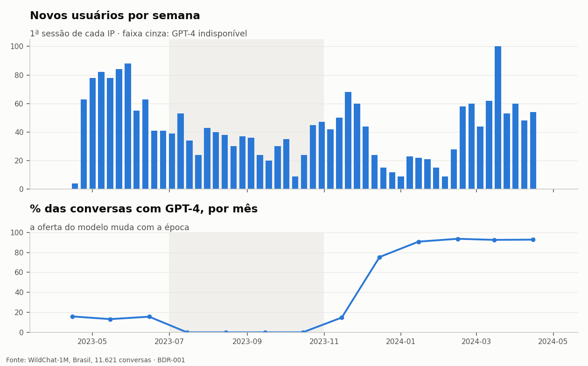
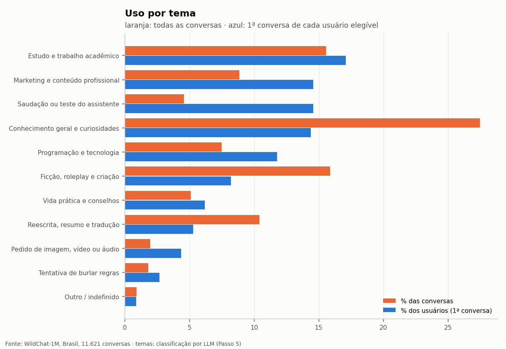
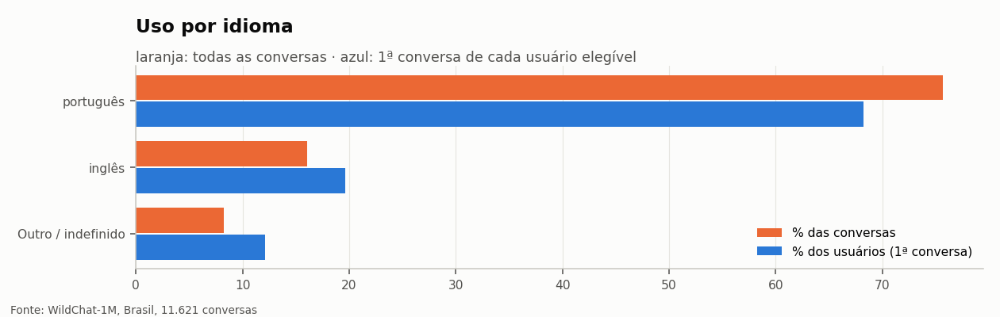
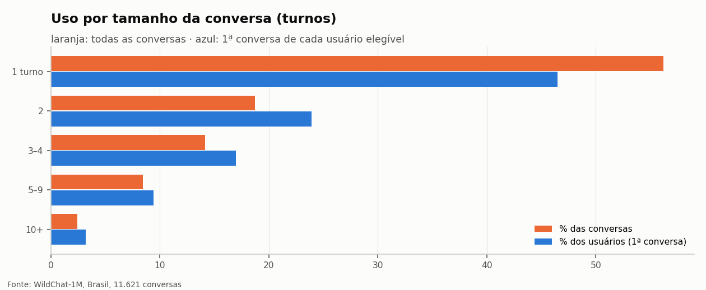
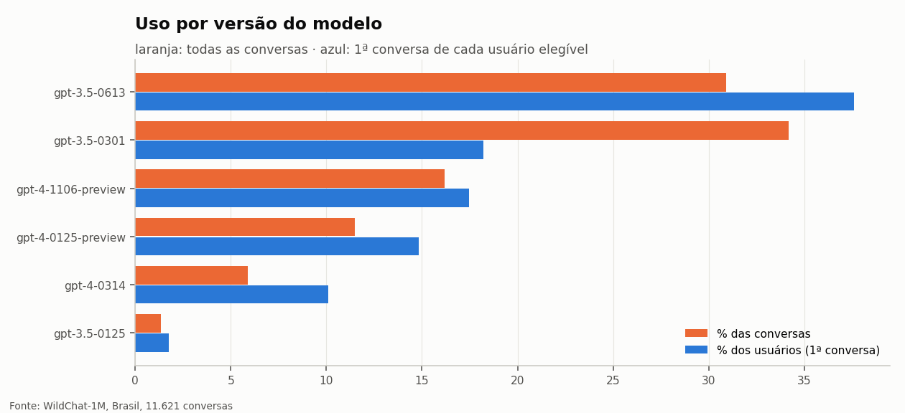
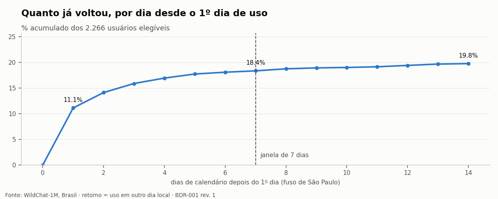
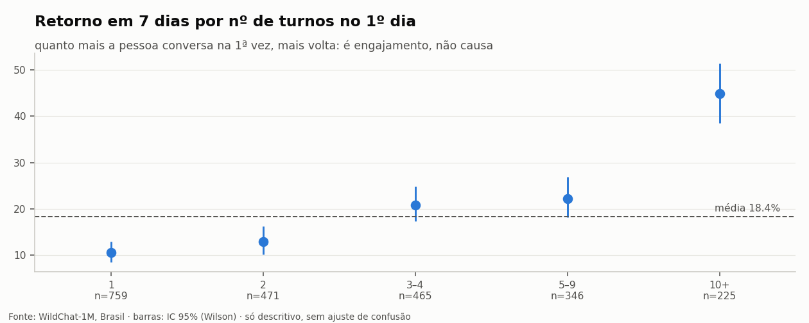
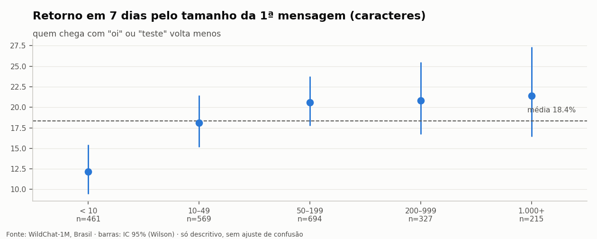

# Passo 4 · Análise exploratória

**Reprodução:** `python -m analise.tabela && python -m analise.eda` (gráficos em `img/`, números impressos).
**Requisito:** AN-3.1-05: "como o **uso** se distribui no tempo, por modelo, idioma, tema e tamanho de conversa", só com os gráficos que levaram a uma conclusão. Tudo aqui é **descritivo**; efeitos com ajuste de confusão são o Passo 6.

Cada gráfico de distribuição compara duas leituras do mesmo uso: **% das conversas** (laranja) e **% dos usuários**, pela 1ª conversa de cada um (azul). A diferença entre as duas é o tamanho da distorção causada por usuários intensos.

## 1. O uso se concentra em poucas pessoas

| Fatia dos IPs | % das conversas |
|---|---:|
| 1% mais ativos | **41,1%** |
| 5% mais ativos | 59,2% |
| 10% mais ativos | 68,9% |

77,5% dos usuários usam o assistente **em um único dia** em toda a base.
**Conclusão:** qualquer número "por conversa" descreve os usuários intensos, não a pessoa típica. A análise de retorno é **por usuário** (1 linha por pessoa).

## 2. No tempo: a chegada e a oferta do modelo mudam

- A chegada de novos usuários tem dois picos (mai/2023 e mar/2024) e um vale em dez/2023–jan/2024.
- O GPT-4 some de jul a out/2023 e passa a ser **a maioria (75–94%)** a partir de dez/2023.

**Conclusão:** GPT-4 × GPT-3.5 só se compara **dentro do período**; a passagem do GPT-4 de opcional para padrão ajuda a separar escolha de efeito (Passo 6).

## 3. Por tema: a 1ª conversa é diferente do uso recorrente

| Tema | % conversas | % usuários (1ª conversa) |
|---|---:|---:|
| Estudo e trabalho acadêmico | 15,6 | 17,1 |
| Marketing e conteúdo profissional | 8,9 | 14,6 |
| **Saudação ou teste do assistente** | 4,6 | **14,6** |
| Conhecimento geral | 27,5 | 14,4 |
| Programação e tecnologia | 7,5 | 11,8 |
| Ficção, roleplay e criação | 15,9 | 8,2 |
| Vida prática e conselhos | 5,1 | 6,2 |
| Reescrita, resumo e tradução | 10,4 | 5,3 |
| **Pedido de imagem, vídeo ou áudio** | 2,0 | **4,4** |
| Tentativa de burlar regras | 1,8 | 2,7 |
| Outro / indefinido | 0,9 | 0,9 |

**Conclusão:** 1 em cada 7 pessoas começa **só testando** o assistente, e 1 em cada 23 começa **pedindo imagem, vídeo ou áudio**, algo que um assistente de texto não entrega. Ficção e reescrita pesam o dobro nas conversas do que nas primeiras conversas: são usos de quem já fica.

## 4. Por idioma, tamanho e modelo

| | % conversas | % usuários (1ª conversa) |
|---|---:|---:|
| Português · inglês · outro | 75,7 · 16,1 · 8,2 | 68,3 · 19,6 · 12,1 |
| 1 turno · 2 · 3–4 · 5–9 · 10+ | 56,2 · 18,7 · 14,2 · 8,4 · 2,4 | 46,5 · 23,9 · 17,0 · 9,4 · 3,2 |

**Conclusões:** o uso é majoritariamente em português; **metade das conversas tem um único turno**; a versão do modelo segue o calendário de oferta (gpt-3.5-0301 em abr–jun/23, 0613 em jul–nov/23, gpt-4 preview depois), então "versão do modelo" é quase sinônimo de "época".

## 5. Quem volta, volta logo

| Dias de calendário depois do 1º dia | 1 | 3 | 7 | 14 |
|---|---:|---:|---:|---:|
| % que já voltou | 11,1% | 15,9% | **18,4%** | 19,8% |

**Conclusão:** 60% dos retornos em 7 dias acontecem **no dia seguinte**, e a janela de 14 dias acrescenta só 1,4 pp. O que decide o retorno está no 1º dia e na manhã seguinte.

## 6. Quem conversa mais no 1º dia volta mais, mas é engajamento, não causa

| Turnos no 1º dia | 1 | 2 | 3–4 | 5–9 | 10+ |
|---|---:|---:|---:|---:|---:|
| n | 759 | 471 | 465 | 346 | 225 |
| Retorno (IC 95%) | 10,5% (8,6–12,9) | 13,0% (10,2–16,3) | 20,9% (17,4–24,8) | 22,3% (18,2–26,9) | 44,9% (38,5–51,4) |

**Conclusão:** relação forte e monotônica, mas a mesma disposição que faz a pessoa conversar mais a faz voltar. Turnos entram no Passo 6 como **mediador**, separado dos fatores que o produto controla.

## 7. Quem chega com "oi" ou "teste" volta menos

| Caracteres da 1ª mensagem | < 10 | 10–49 | 50–199 | 200–999 | 1.000+ |
|---|---:|---:|---:|---:|---:|
| n | 461 | 569 | 694 | 327 | 215 |
| Retorno (IC 95%) | 12,1% (9,5–15,4) | 18,1% (15,2–21,5) | 20,6% (17,8–23,8) | 20,8% (16,7–25,5) | 21,4% (16,4–27,4) |

**Conclusão:** o salto é entre "< 10" e o resto; acima de 50 caracteres a taxa é plana. A 1ª mensagem curta mede **intenção ao chegar** (curiosidade, teste), traço do perfil e não da resposta. Entra no Passo 6 como **confundidor**.

## Gráficos descartados

Retorno por idioma, dispositivo, faixa horária e fim de semana foram olhados (tabela no Passo 3), mas sem ajuste não levam a conclusão. Vão direto para o modelo do Passo 6.
