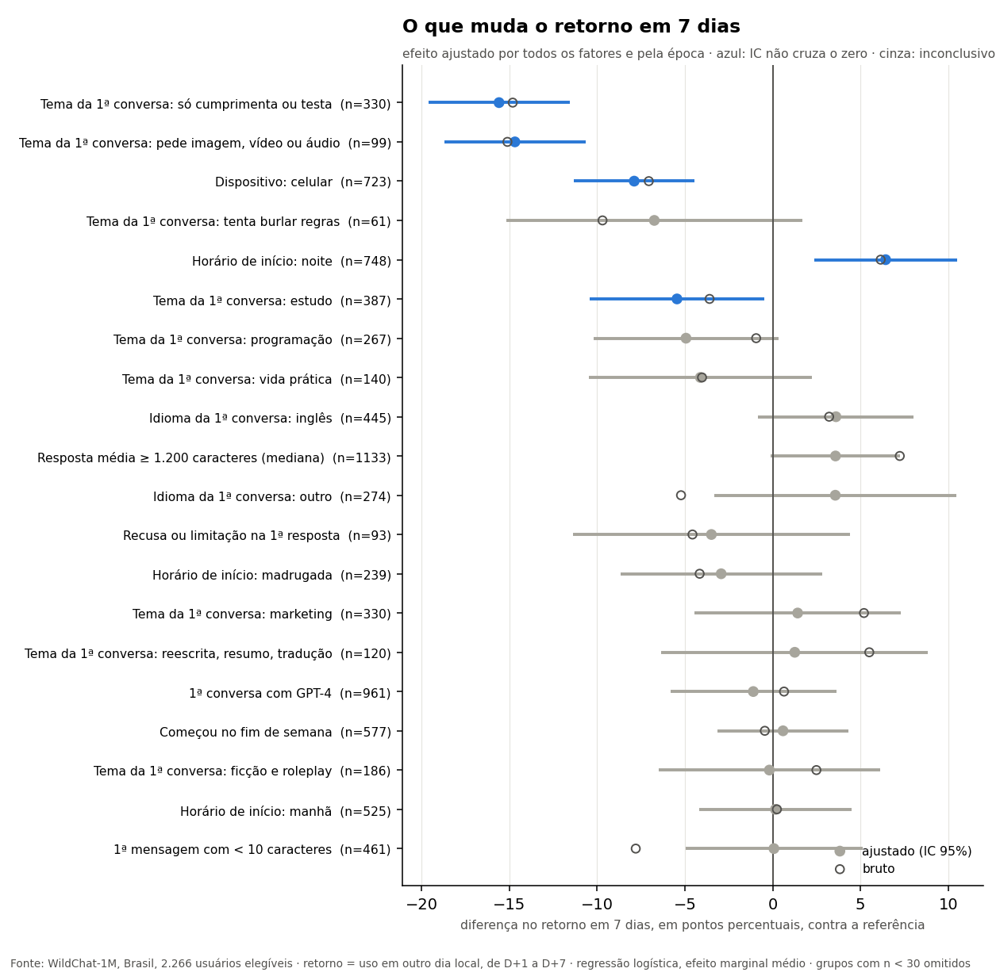

# Passo 6 · A resposta: o que faz quem experimentou voltar em até 7 dias

**Pergunta do cliente:** o que faz uma pessoa que experimentou o assistente voltar a usá-lo em até 7 dias? Quais fatores têm o maior efeito, quanto pesa cada um e quanto disso é causa e não seleção?
**Reprodução:** `python -m analise.tabela && python -m analise.efeitos && python -m analise.semana 2023-11-20`.

**Base:** 2.266 pessoas que usaram o assistente pela 1ª vez entre abr/2023 e abr/2024 (Brasil). **18,4% voltaram** em outro dia, entre o 1º e o 7º dia (IC 95%: 16,8–20,0). Definições: [BDR-001](../bdr/BDR-001-definicoes-de-uso-e-retorno.md).

## 1. Efeito de cada fator, com incerteza, ordenado pelo tamanho

**Método.** Regressão logística com todos os fatores ao mesmo tempo e a época (regime de oferta do GPT-4) como controle; o efeito é o **efeito marginal médio**: quantos pontos percentuais o retorno muda quando o fator está presente, com os demais iguais. IC 95% pelo método delta, erros robustos (HC1). O modelo convergiu (pseudo-R² = 0,059: a 1ª experiência explica pouco do retorno, o que é esperado com tão pouca informação por pessoa).

| Fator (contra a referência) | n | Retorno | Bruto (pp) | **Ajustado (pp) [IC 95%]** | Leitura |
|---|---:|---:|---:|---:|---|
| 1ª conversa **só cumprimenta ou testa** (vs. conhecimento geral) | 330 | 6,4% | −14,8 | **−15,6 [−19,6; −11,6]** | Efeito claro |
| 1ª conversa **pede imagem, vídeo ou áudio** | 99 | 6,1% | −15,1 | **−14,7 [−18,7; −10,7]** | Efeito claro |
| **Celular** (vs. computador) | 723 | 13,6% | −7,1 | **−7,9 [−11,3; −4,4]** | Efeito claro |
| Começou **à noite** (vs. tarde) | 748 | 22,9% | +6,2 | +6,4 [+2,4; +10,5] | Em parte **efeito da definição**: quem começa às 23h e continua depois da meia-noite já "voltou outro dia" |
| 1ª conversa de **estudo** | 387 | 17,6% | −3,6 | −5,4 [−10,4; −0,5] | Efeito pequeno, no limite |
| 1ª conversa tenta **burlar regras** | 61 | 11,5% | −9,7 | −6,7 [−15,2; +1,7] | Inconclusivo (n pequeno) |
| Resposta média longa (≥ 1.200 caracteres) | 1.133 | 22,0% | +7,2 | +3,6 [−0,1; +7,3] | Inconclusivo; metade do bruto era confusão |
| **Recusa ou limitação na 1ª resposta** | 93 | 14,0% | −4,6 | −3,5 [−11,4; +4,4] | Inconclusivo (n pequeno) |
| **1ª conversa com GPT-4** | 961 | 18,7% | +0,6 | **−1,1 [−5,8; +3,6]** | **Sem efeito detectável** |
| 1ª mensagem com < 10 caracteres | 461 | 12,1% | −7,8 | +0,1 [−5,0; +5,1] | O bruto era o tema "só testa": absorvido |
| Demais (idioma, fim de semana, outros temas) | — | — | — | IC cruza o zero | Inconclusivo |

**Mediadores (fora do modelo principal, porque acontecem junto com o desfecho):** quem tem **5 ou mais turnos no 1º dia** volta 31,2% (+17,1 pp bruto); quem usa **mais de um tema no 1º dia**, 29,9% (+13,2 pp). Eles descrevem *como* o retorno acontece (engajamento), não *por que*: não são alavancas que o produto puxa diretamente.

**Qualidade da resposta (subanálise).** Entre as 1.149 pessoas que mandaram mais de uma mensagem na 1ª conversa, as que corrigiram, repetiram ou reclamaram (342) voltam 21,9% contra 22,2%: **−2,1 pp [−7,2; +3,0]**, inconclusivo. O sinal de insatisfação é estável (κ = 0,93 entre duas execuções do classificador), então a ausência de efeito não é ruído de medida.

## 2. Causa ou seleção?

**O que pode confundir.** Quem escolhe o GPT-4 já pode ser mais engajado; quem começa com "oi" pode só estar curioso; quem usa computador pode estar trabalhando. Os confundidores tratados:

| Confundidor | Como foi tratado |
|---|---|
| Época (oferta do GPT-4 muda de 0% a 94% ao longo do ano) | Controle no modelo; IPW sem o período em que o GPT-4 não existia |
| Intenção ao chegar (mensagem curta, só testar) | Tema da 1ª conversa e tamanho da 1ª mensagem no modelo |
| Perfil (dispositivo, idioma, horário, dia) | No modelo e no escore de propensão |
| Engajamento | Mantido **fora** como mediador: controlar por ele apagaria justamente o efeito de uma boa 1ª experiência |

**GPT-4: três estimativas concordam que o modelo não muda o retorno.**

| Estimativa | Diferença no retorno (pp) [IC 95%] |
|---|---:|
| Bruta | +0,6 |
| Ajustada (regressão) | −1,1 [−5,8; +3,6] |
| **IPW** (escore de propensão com época, horário, dia, dispositivo, idioma, tamanho da 1ª mensagem e tema; maior desequilíbrio entre grupos cai de 1,48 para 0,21 desvio-padrão) | +2,9 [−1,7; +7,3] |
| **Quando a pessoa escolhia o GPT-4** (abr–jun/23 e nov/23) | +1,7 [−3,6; +7,5] |
| **Quando o GPT-4 era o padrão** (dez/23–abr/24, ~90% das conversas) | +1,3 [−8,0; +8,4] |

Se a escolha do GPT-4 fosse seleção de gente mais engajada, o efeito seria maior quando a pessoa escolhia do que quando era padrão; os dois são iguais e compatíveis com zero. **Conclusão: não há efeito do modelo sobre o retorno que estes dados consigam detectar, nem sinal de seleção relevante.**

**Temas de chegada ("só testa", "pede imagem"): parte é seleção, parte é produto.** "Só testa" mede sobretudo intenção de quem chegou (o assistente não escolhe quem chega curioso), mas a resposta do produto a quem chega assim é uma alavanca. "Pede imagem" é diferente: a pessoa chegou com uma necessidade concreta que um assistente de texto **não atende** (20,7% dessas conversas têm recusa ou limitação declarada, contra 5,2% no resto). É uma falha de produto observável.

**O que a análise prova e o que não prova.**
- **Prova (com a incerteza dos IC):** quem chega só testando ou pedindo imagem volta muito menos, mesmo comparando pessoas com o mesmo dispositivo, idioma, horário e época; e a escolha do modelo não muda o retorno.
- **Não prova:** que mudar a 1ª experiência dessas pessoas fará elas voltarem. Sem experimento, há confusão não observada possível (motivação, necessidade real). A prova causal exige um **teste A/B** da mudança proposta.
- **Não mede:** quem voltou com conversas tóxicas (retiradas da base pública: o retorno é um limite inferior) e pessoas que trocam de IP (usuário = IP).

## 3. A semana que mudou: 20/11/2023

| | Novos | Voltaram | Retorno |
|---|---:|---:|---:|
| 4 semanas anteriores (23/10–19/11) | 188 | 43 | 22,9% |
| **Semana de 20/11/2023** | 64 | 8 | **12,5%** |
| Diferença | | | **−10,4 pp** (p = 0,044) |

**Por que esta semana:** é a semana do incidente do enunciado e, na base real, também é uma semana atípica: chegaram 64 pessoas, contra ~47 por semana nas anteriores, logo depois da volta do GPT-4 ao assistente.

**Mudou o perfil ou a taxa?** Decomposição de Kitagawa (Δ = mix + taxa):

| Segmentação | Mix (perfil de quem chegou) | Taxa (retorno dentro de cada perfil) |
|---|---:|---:|
| Pedido real × só testa / pede imagem / burla | −0,4 pp | **−10,0 pp** |
| Computador × celular | +0,3 pp | **−10,7 pp** |
| GPT-4 × GPT-3.5 | −0,4 pp | **−10,0 pp** |

**O perfil de quem chegou praticamente não mudou** (a fatia de "só testa" foi de 19% para 22%, a de celular de 26% para 22%); **a queda está na taxa**, concentrada em quem chegou com pedido real pelo computador (de 27% para 14%).

**Mas a queda é provavelmente acaso.** Com ~50 pessoas por semana, a oscilação natural é grande: o teste de homogeneidade entre as 37 semanas com n ≥ 30 **não rejeita** que todas tenham o mesmo retorno (χ² = 42,6; 36 gl; **p = 0,21**). O p = 0,044 desta semana, isolado, não sobrevive à comparação com 37 semanas (seriam esperadas ~2 semanas assim só por acaso). **Decisão que isso sustenta:** o dashboard não deve alarmar com variação semanal; mostra a faixa esperada pelo acaso e usa janela móvel de 4 semanas para tendência.

## 4. Três achados para o cliente e a decisão que cada um sustenta

| # | Achado | Decisão |
|---|---|---|
| 1 | **1 em cada 5 pessoas chega só testando (14,6%) ou pedindo imagem/vídeo/áudio (4,4%), e essas pessoas voltam ~6%, contra ~21% de quem chega com um pedido real** (−15 pp, efeito ajustado). | Redesenhar a **1ª resposta para quem só testa** (mostrar 3 usos concretos com exemplos clicáveis) e **responder pedidos de imagem** com uma alternativa útil (descrever, gerar o prompt, indicar a ferramenta) em vez de só recusar. Validar com A/B. Potencial: fechar metade da distância nesses grupos = **+1,4 pp no retorno total**. |
| 2 | **O modelo (GPT-4 × GPT-3.5) não muda o retorno**, nem quando a pessoa escolhe nem quando é o padrão. | **Não usar modelo mais caro como alavanca de retenção**: investir na 1ª experiência, não no modelo. |
| 3 | **Quem chega pelo celular volta 8 pp menos** com o mesmo tema, idioma, horário e época. | **Auditar a experiência no celular** (carregamento, teclado, formato das respostas longas) e testar uma versão otimizada em A/B; até lá, tratar celular como segmento de risco no acompanhamento. |

## 5. Sugestões que saíram dos dados

**Para o assistente:** tratar "só testando" como intenção de descoberta (onboarding com exemplos); para pedido de imagem/mídia, uma resposta útil em vez de "não consigo"; atenção a temas de estudo (−5 pp), em que a resposta pode estar menos aderente ao que o estudante precisa.

**Para o dashboard**, indicadores pensados só depois de olhar os dados:
- **% de chegadas "só testando" ou "pedindo mídia"** por semana: o maior fator de não retorno, acompanhável;
- **retorno por dispositivo** como segmento fixo;
- **faixa esperada pelo acaso** em cada coorte semanal, para não alarmar com ruído;
- **sensibilidade da definição** visível ("se voltar no mesmo dia contasse, seria 28%").

## 6. O que os dados permitem, o que não permitem e o que falta

| Permitem | Não permitem | Faltaria para responder melhor |
|---|---|---|
| Comparar quem voltou e quem não voltou pela 1ª experiência | Identificar a pessoa (só o IP; mesma pessoa em 2 redes vira 2) | **ID de usuário** (login ou cookie) |
| Medir efeitos associados com incerteza e ajuste de confusão observada | Provar causa sem experimento | **Testes A/B** de onboarding e de resposta a pedido de imagem |
| Classificar temas e sinais de insatisfação a partir do texto | Saber se a pessoa ficou satisfeita | **Avaliação da resposta pelo usuário** (👍/👎) |
| Ver o horário de cada resposta | Ver o horário de cada pergunta (só o assistente tem horário) | Horário das mensagens do usuário |
| Medir retorno de quem ficou na base | Ver conversas tóxicas (removidas da base pública) | A base completa |
