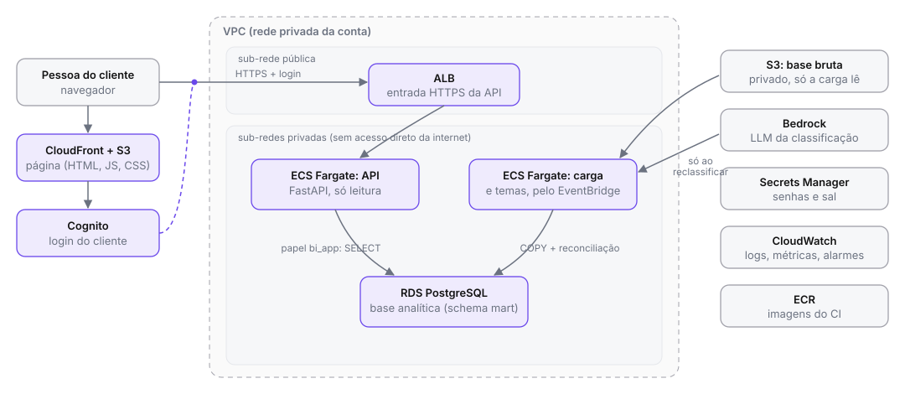

# Arquitetura AWS

Como o dashboard roda na AWS: os mesmos containers do `docker compose`, em serviços gerenciados. O desenho segue a regra do projeto: o dashboard nunca lê a base bruta, o número é calculado no banco e a tela só exibe.

## Componentes

| Serviço | Papel | Por quê |
|---|---|---|
| **S3** (bucket privado) | base bruta (parquet do Brasil) e rótulos de tema versionados | barato, versionável; só a carga tem permissão de leitura |
| **ECS Fargate: carga** | a mesma imagem do serviço `etl`, rodando uma vez por dia | não há servidor ligado à toa: a tarefa sobe, carrega, confere e termina |
| **EventBridge** | agenda a carga (por exemplo, todo dia às 3h) e a reclassificação dos temas, quando necessária | agendamento gerenciado, sem cron em máquina própria |
| **Bedrock** | LLM da classificação de temas | o modelo e o custo ficam na AWS; a troca de modelo é só configuração (LangChain, ver DOCUMENTO §4) |
| **RDS PostgreSQL** | base analítica (schema `mart`) | volume pequeno; backup automático; SQL legível por qualquer pessoa da equipe de dados |
| **ECS Fargate: API** | a mesma imagem do serviço `app` (FastAPI), sempre ligada | API fina, só leitura, com cache por versão da carga |
| **ALB** | entrada HTTPS da API, com certificado | distribui entre as tarefas da API e confere a saúde (`/healthz`) |
| **Cognito** | login do cliente, integrado ao ALB | cada cliente vê só o próprio dashboard |
| **CloudFront + S3** | entrega a página (HTML, JS, CSS) | rápido e barato; a página é estática |
| **Secrets Manager** | senhas do banco e o sal do pseudônimo | nenhum segredo no código ou na imagem |
| **CloudWatch** | logs JSON, métricas e alarmes da carga e da API | um lugar só para investigar |
| **ECR** | guarda as imagens geradas pelo CI | o deploy usa exatamente a imagem testada |

## Dois caminhos

**Uma carga.** O EventBridge dispara a tarefa de carga, que lê a base bruta e os rótulos de tema no S3, aplica as definições, roda a análise estatística e grava no RDS numa transação só. Antes de publicar, ela confere o retorno calculado em SQL contra o calculado em Python; se divergir, nada é publicado e um alarme dispara. A carga nunca chama o LLM: a classificação dos temas é uma tarefa separada, rodada só quando os temas precisam ser refeitos, e grava os rótulos versionados no S3.

**Uma visita.** A pessoa abre o endereço do dashboard: a página vem do CloudFront. O login passa pelo Cognito. A página chama a API pelo ALB; a API consulta o RDS com o papel `bi_app`, que só lê o schema `mart`, e guarda a resposta em memória até a próxima carga.

## Rede e segurança

- **Rede:** só o ALB e o CloudFront ficam expostos à internet. A API, a carga e o banco ficam em sub-redes privadas; o RDS não tem acesso público.
- **Quem fala com quem:** a API e a carga chegam ao banco pela porta 5432, liberada só para elas. O acesso a S3, Bedrock e Secrets Manager usa endpoints privados da VPC, sem passar pela internet.
- **Permissões por serviço (IAM):** a carga lê o bucket da base bruta, chama o Bedrock e lê os seus segredos; a API lê só o segredo do papel `bi_app`. Ninguém além da carga lê a base bruta.
- **Criptografia:** em repouso no S3 e no RDS (chaves do KMS) e em trânsito (HTTPS e TLS no banco).
- **Dados pessoais:** a base bruta tem texto de conversas e fica no bucket privado. A base analítica não guarda texto, IP nem navegador, e a API não devolve números de grupos com menos de 30 pessoas.

## Ambientes e deploy

- **Ambientes:** desenvolvimento, homologação e produção, separados (contas ou VPCs diferentes), todos com a mesma imagem.
- **Infraestrutura como código:** CDK ou Terraform, para recriar qualquer ambiente igual.
- **Deploy:** a cada mudança, o CI roda lint, tipagem e testes; gera a imagem; guarda no ECR; atualiza a homologação. A homologação recebe a carga completa e a reconciliação; só depois a mesma imagem vai para produção (troca gradual das tarefas, com volta automática se a saúde falhar).
- **Banco:** as migrações são arquivos novos, nunca editados, aplicados pela carga e registrados em `mart.migracoes`.

## Monitoramento e alarmes

| O que se mede | Onde | Alarme |
|---|---|---|
| Carga: duração, linhas lidas, reconciliação | logs e métricas da tarefa; `mart.cargas` | carga com erro, reconciliação falhou ou carga que não rodou no dia |
| Número de pessoas: razão "pessoas ÷ IPs" por semana | métrica da carga | razão fora do histórico (o sintoma do incidente) |
| API: tempo por rota (p50, p95), erros | logs JSON com `request_id` | p95 alto ou erros 5xx acima do normal |
| Banco: conexões, CPU, espaço | métricas do RDS | uso perto do limite |

## Custo

Entram na conta: as horas das tarefas Fargate (a API sempre ligada e a carga alguns minutos por dia), a instância pequena do RDS, o armazenamento no S3, o tráfego do CloudFront, os tokens do Bedrock (só quando os temas são reclassificados) e os logs do CloudWatch. Os maiores itens são o RDS e a API sempre ligada; a carga e o LLM pesam pouco. O valor é estimado na calculadora de preços da AWS, com a região e o volume de acessos do cliente.

## Se o uso crescer

1. **Mais acessos:** o CloudFront passa a guardar também as respostas da API, com a versão da carga no endereço, e o ALB distribui entre mais tarefas da API.
2. **Cache compartilhado:** com muitas tarefas da API, um Redis gerenciado (ElastiCache) evita que cada uma refaça as mesmas consultas.
3. **Mais leitura no banco:** uma réplica de leitura do RDS.
4. **Muito mais dados** (vários países, anos de histórico): a base analítica migra para um armazém colunar (Redshift ou Athena sobre S3), mantendo as mesmas definições e testes.
